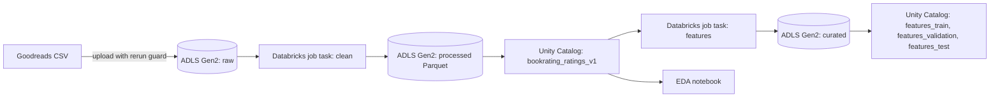

# Book Rating Prediction

**Course:** DSAI3202 Fall 2026, Project Phase 1
**Team:** Aysha Ghannam (60308393) and Nour Ben Ayed (60305269)

---

## 1. Project and hypothesis

- **Problem:** predict the 1-5 star rating a reader would give a book.
- **Target:** `rating`, an explicit whole-star rating from 1 to 5.
- **Baseline plan:** predict the book's average training rating. For books unseen in training, predict the overall training average.
- **Hypothesis:** a Random Forest using reader and book rating histories will achieve a lower test mean absolute error (MAE) than the baseline.
- **Approved refinements:** none.
- **Scope:** Phase 1 builds and validates the data pipeline and features. Model training and evaluation are Phase 2.

The dataset is Goodreads (UCSD Book Graph).

---

## 2. Dataset and architecture

### Source and ingestion

| Item | Detail |
|---|---|
| Dataset | Goodreads interactions, UCSD Book Graph |
| Source link | https://mcauleylab.ucsd.edu/public_datasets/gdrive/goodreads/goodreads_interactions.csv |
| Format and size | CSV, 4,318,621,741 bytes (4.319 GB, shown as 4.02 GiB in Azure) |
| Version | `v1` |
| Raw schema | `user_id`, `book_id`, `is_read`, `rating`, `is_reviewed` |
| Ingestion mode | Batch: download once, upload to the Azure raw container |
| Refresh strategy | Fixed snapshot. A new release would go to a new versioned path (for example `v2`); `v1` is never overwritten. |
| Manifest | [`manifests/manifest_v1.json`](manifests/manifest_v1.json) |
| SHA-256 | `A204BCD79E3DEC594B3D8DA6CBFF68598D121C087FF38E7A05589C019EC830EB` (the original and the copy downloaded back from Azure matched) |

**Repeat ingestion.** [`notebooks/04_verify_ingestion_rerun.py`](notebooks/04_verify_ingestion_rerun.py) finds exactly one raw file, checks its size against the manifest, skips the upload, and asserts that path, size and modification time are unchanged. Output: [`evidence/ingestion_rerun.txt`](evidence/ingestion_rerun.txt).

A rating of 0 means the reader gave no explicit rating, so those rows are excluded from the prediction dataset.

### Storage layout

| Layer | Location (storage account `bookrating60308393`) | Contents |
|---|---|---|
| Raw | `raw` container, `goodreads/v1/goodreads_interactions.csv` | Original CSV, never modified |
| Processed | `processed` container, `goodreads/v1/_staging/ratings_a539f0c69fe247f690d2860544c8a9c0/` | Cleaned ratings, 33 Snappy Parquet files |
| Reports | `processed` container, `goodreads/v1/run_reports/` | One JSON cleaning report per run |
| Curated | `curated` container, `goodreads/v1/features/{train,validation,test}/` | Feature outputs |

### Architecture



| Azure service | Role |
|---|---|
| Azure Data Lake Storage Gen2 | Raw, processed and curated storage |
| Azure Databricks | Compute for cleaning, features and EDA; the job `proj-bookrating-phase1` runs `clean` then `features` |
| Unity Catalog | Catalog of the cleaned table and the three feature tables |

### Catalog and lineage

**Lineage:** raw CSV -> processed Parquet -> `bookrating_ratings_v1` -> `features_train`, `features_validation`, `features_test`.

**Cleaned table:** `dsai3202_databricks.proj_bookrating.bookrating_ratings_v1`, one row per reader-book pair. Table and column descriptions are saved in Unity Catalog by notebook 01.

| Column | Type | Description |
|---|---|---|
| `user_id` | bigint | Reader ID; with `book_id`, the logical unique key |
| `book_id` | bigint | Book ID; with `user_id`, the logical unique key |
| `is_read` | int | Source read indicator, 0 or 1; kept for reference |
| `rating` | int | Explicit rating 1-5; the prediction target |
| `is_reviewed` | int | Source review indicator, 0 or 1; kept for reference |

The key is logical, not enforced by the table; uniqueness is checked on every run.

---

## 3. Run the pipeline

### Prerequisites

- Access to the `dsai3202-databricks` workspace and to the `dsai3202_databricks.proj_bookrating` schema.
- A cluster on Databricks Runtime 18 LTS (the job used two workers, 4 cores and 16 GB each). Everything used (PySpark, Spark SQL) comes with the runtime, so there is no separate dependency file.
- Read and write access to storage account `bookrating60308393` (containers `raw`, `processed`, `curated`).
- The raw CSV uploaded to `raw/goodreads/v1/`. To set up from scratch: create the three containers, download the CSV from the source link, upload it, and compare its SHA-256 with the manifest.

### Files

| File | Purpose |
|---|---|
| [`notebooks/01_clean_goodreads (1).py`](notebooks/01_clean_goodreads%20%281%29.py) | Validate, clean, publish and register the ratings |
| [`notebooks/02_prepare_features.py`](notebooks/02_prepare_features.py) | Splits, features, validation, publication |
| [`notebooks/03_eda_goodreads.py`](notebooks/03_eda_goodreads.py) | Exploratory analysis and storage sizes |
| [`notebooks/04_verify_ingestion_rerun.py`](notebooks/04_verify_ingestion_rerun.py) | Raw-file rerun check |
| [`jobs/proj-booking-phase1.json`](jobs/proj-booking-phase1.json) | Exported job configuration for `proj-bookrating-phase1` |
| [`tests/fixture_missing_rating.csv`](tests/fixture_missing_rating.csv) | Test input without the `rating` column |

### Run the automated job

1. Import the notebooks into the workspace. Create the job from the exported JSON (Jobs & Pipelines, create from JSON) and set the notebook paths and `existing_cluster_id` to your workspace and cluster.
2. Start the cluster, open the job `proj-bookrating-phase1` and click **Run now**. Keep the default `input_path` (the raw `v1` CSV). The `features` task runs only after `clean` succeeds.
3. Check the published counts:

```sql
REFRESH TABLE dsai3202_databricks.proj_bookrating.features_train;
REFRESH TABLE dsai3202_databricks.proj_bookrating.features_validation;
REFRESH TABLE dsai3202_databricks.proj_bookrating.features_test;

SELECT 'train' AS split, COUNT(*) AS n FROM dsai3202_databricks.proj_bookrating.features_train
UNION ALL SELECT 'validation', COUNT(*) FROM dsai3202_databricks.proj_bookrating.features_validation
UNION ALL SELECT 'test', COUNT(*) FROM dsai3202_databricks.proj_bookrating.features_test;
```

Expected: 83,638,178 (train), 10,457,550 (validation), 10,455,821 (test).

### Run the notebooks manually

Run `01_clean_goodreads` first, then `02_prepare_features` or `03_eda_goodreads` (EDA does not need the feature tables). `04_verify_ingestion_rerun` can be run at any time. See also [`notebooks/README.md`](notebooks/README.md).

### Controlled failure test

Run the job once with `input_path` overridden to the full Azure path of a separate copy of `tests/fixture_missing_rating.csv`. Use the default `input_path` again for normal runs.

---

## 4. Results and features

### Row accounting

| Measure | Result |
|---|---:|
| Raw interactions | 228,648,342 |
| Unrated interactions excluded (rating 0) | 124,096,793 |
| Explicit ratings saved | 104,551,549 |
| Invalid field values | 0 |
| Repeated reader-book pairs | 0 |

228,648,342 - 124,096,793 = 104,551,549. The only excluded rows are the unrated ones. A cleaning report for each run is saved to `processed/goodreads/v1/run_reports/`.

### Quality rules

Order: read raw -> check columns -> convert types with `try_cast` (bad values become null and are counted as invalid) -> check values -> check duplicates -> filter to ratings 1-5 -> write Parquet -> verify -> register table -> write report.

Publication stops (the notebook raises an error) if:

- the columns are not exactly `user_id`, `book_id`, `is_read`, `rating`, `is_reviewed`;
- any `user_id` or `book_id` is null or negative, any `rating` is null or outside 0-5, or `is_read` or `is_reviewed` is not 0 or 1;
- any reader-book pair is repeated, or there are no explicit ratings;
- input rows do not equal explicit plus unrated rows;
- the saved row count or column types differ from the expected ones, or the table already points to a different output.

For features, `02_prepare_features` writes to a staging folder and publishes only if there are no missing, non-finite or out-of-range feature values (averages 1-5, counts at least 0), no lost or duplicated rows, and split counts match. A failure leaves the previous published outputs in place.

### Runs

Job `proj-bookrating-phase1` (ID `741628860534238`). Screenshots: [`evidence/job_runs/`](evidence/job_runs/).

| Test | Run ID | Duration | Result |
|---|---|---|---|
| Successful run | `692763854509075` | 9m 35s | Both tasks succeeded |
| Rerun | `79041621458263` | 9m 30s | Succeeded; counts matched, no duplicate rows |
| Controlled failure (no `rating` column) | `993624055488619` | 26s | `clean` rejected the input; `features` skipped; published tables unchanged |
| Normal run after failure | `34636616976155` | 9m 34s | Succeeded with the expected counts |

Other checks: the cleaning rerun reused the published data and report (still 104,551,549 rows, same column types), and notebook 01 also tests a missing-`rating` input and confirms the published files are unchanged.

### Splits

`02_prepare_features` hashes `user_id` and `book_id` into 100 buckets: 0-79 train, 80-89 validation, 90-99 test. The same pair always lands in the same split. No sampling is used anywhere in Phase 1.

| Split | Rows |
|---|---:|
| Train | 83,638,178 |
| Validation | 10,457,550 |
| Test | 10,455,821 |
| **Total** | **104,551,549** |

No pair appears in more than one split.

### Output paths

Feature outputs are in `abfss://curated@bookrating60308393.dfs.core.windows.net/goodreads/v1/features/` under `train/`, `validation/` and `test/`, registered as `features_train`, `features_validation` and `features_test`. A rerun replaces these folders instead of appending.

### Exploratory analysis

EDA ([`notebooks/03_eda_goodreads.py`](notebooks/03_eda_goodreads.py)) ran on the **full** cleaned dataset, not a sample.

| Finding | Value |
|---|---|
| Ratings, readers, books | 104,551,549; 816,371; 2,325,541 |
| Mean rating | 3.939 |
| Share of 4 and 5 star ratings | 69.83% |
| Median ratings per reader / per book | 55 / 4 |
| Books / readers with fewer than 5 ratings | 51.34% / 8.09% |
| Correlation of `log(1 + book rating count)` with average book rating | 0.0219 |

**Risks and what they mean for modeling.**

- Ratings are skewed high, so a constant near 4 is already a strong baseline. The model must be judged against the baseline MAE.
- Activity is very uneven: the median book has 4 ratings. Averages from short histories are unstable, so every average is paired with a count.
- Many validation and test rows will involve books or readers with little or no training history, so the features define a fallback for unseen history.
- Popularity (rating count) shows little linear relation to average rating, so counts are kept as separate features.

### Features

All features come from the training split of `bookrating_ratings_v1`.

| Feature | Type | Definition | Available at prediction time |
|---|---|---|---|
| `reader_avg_rating` | double | Average of the reader's eligible training ratings | Yes, from stored training aggregates |
| `reader_rating_count` | long | Number of those ratings | Yes |
| `book_avg_rating` | double | Average of the book's eligible training ratings | Yes |
| `book_rating_count` | long | Number of those ratings | Yes |

The feature tables also keep `user_id`, `book_id`, `rating` (target) and `split`. No feature selection was used.

**Fallbacks.** With `S` the sum and `N` the number of training ratings: for a training row, the row's own rating is removed from its reader and book sums and counts; if no history remains the count is 0 and the average is `(S - rating) / (N - 1)`. Validation and test rows use the full training aggregates; with no history the average is `S / N` and the count is 0. Prediction uses the same rule.

**Leakage risks and mitigations.**

| Risk | Mitigation |
|---|---|
| A training row's rating is inside its own averages | Removed from its features; tested on a small hand-checked example in notebook 02 |
| Validation or test ratings influence features | Aggregates come from training rows only |
| The same pair appears in two splits | Deterministic hash split, checked: no overlap |
| The fallback average includes the row's own rating | The training fallback subtracts the row's rating |
| Unseen readers and books | Count is 0 with the training mean, so the model can recognize them |

**Limitation.** The hash split is random, not time-based, so it does not measure performance on future ratings.

**Next (Phase 2).** Train the Random Forest on `features_train`, tune on validation, and compare MAE with the baseline on test.

---

## 5. Resource use and contributions

### Justified choice: Snappy Parquet instead of CSV

Cleaned ratings are stored as Snappy Parquet. The raw CSV is 4.319 GB and the cleaned output is 0.490 GB in 33 files (88.65% smaller). This compares different row sets and formats, so it reflects both dropping 124,096,793 unrated rows and the columnar format, not compression alone. The smaller, columnar table is what cleaning, EDA and features read. The whole job takes about 9.5 minutes on two 4-core, 16 GB workers (about 6.5 minutes cleaning, 3 minutes features). Validating staged features before publishing adds time to each run; it is kept because the failed run showed it protects the published tables.

### Cleanup

Stop the lab cluster when neither teammate is using it. Keep the raw snapshot, published outputs and run evidence.

### Contributions

#### Aysha Ghannam: ingestion, cleaning and EDA

| Area | Work | Files |
|---|---|---|
| Storage and ingestion | Set up storage account `bookrating60308393` with `raw`, `processed` and `curated` containers. Downloaded the Goodreads CSV, uploaded it to `raw/goodreads/v1/`, and verified the upload by comparing the SHA-256 of the original file with a copy downloaded back from Azure. | [`manifests/manifest_v1.json`](manifests/manifest_v1.json) |
| Rerun guard | Checked that repeating ingestion finds exactly one raw file, skips the upload, and leaves its path, size and modification time unchanged. | [`notebooks/04_verify_ingestion_rerun.py`](notebooks/04_verify_ingestion_rerun.py) |
| Cleaning and validation | Checked the column names, converted types safely with `try_cast`, and checked IDs, ratings and the 0/1 indicator fields. Checked repeated reader-book pairs, excluded the 124,096,793 unrated rows, and reconciled the row counts (228,648,342 input, 104,551,549 saved). Defined the checks that stop publication. | [`notebooks/01_clean_goodreads (1).py`](notebooks/01_clean_goodreads%20%281%29.py) |
| Publication and catalog | Wrote the cleaned ratings as Snappy Parquet, verified the saved row count and column types, registered `bookrating_ratings_v1` in Unity Catalog, added table and column descriptions, and saved a JSON cleaning report for each run. | Same notebook |
| Failure test | Added a missing-`rating` test inside the notebook. Added the `input_path` widget, which the job uses for the controlled failure run. | Same notebook |
| EDA and measurements | Analysed rating distribution, reader and book activity, short-history shares, and the correlation between book rating count and average rating on the full cleaned dataset. Measured the raw CSV against the cleaned Parquet size (4.319 GB to 0.490 GB, 88.65% smaller). | [`notebooks/03_eda_goodreads.py`](notebooks/03_eda_goodreads.py) |
| Documentation | Combined both members' work into the README. | `README.md` |

#### Nour Ben Ayed: splits, features and automation

| Area | Work | Files |
|---|---|---|
| Reproducible splits | Built the hash split of `user_id` and `book_id` into 100 buckets (0-79 train, 80-89 validation, 90-99 test). Checked that the split counts add up to 104,551,549 and that no reader-book pair appears in more than one split. | [`notebooks/02_prepare_features.py`](notebooks/02_prepare_features.py) |
| Features | Built `reader_avg_rating`, `reader_rating_count`, `book_avg_rating` and `book_rating_count` from training ratings only. Removed each training row's own rating from its features, and defined the fallback for readers and books with no history. | Same notebook |
| Leakage test | Tested target exclusion and the fallbacks on a small hand-checked table with known answers before running on the full data. | Same notebook |
| Validation and publication | Wrote features to a staging folder and checked them for missing or non-finite values, averages outside 1-5, negative counts, and lost or duplicated rows. Published only if all checks passed, replaced the old folders so reruns don't add duplicates, and registered `features_train`, `features_validation` and `features_test`. | Same notebook |
| Automated job | Configured the Databricks job `proj-bookrating-phase1` with `features` depending on `clean`, and exported its configuration. | [`jobs/proj-booking-phase1.json`](jobs/proj-booking-phase1.json) |
| Job tests | Ran the job four times: success, rerun, controlled failure and recovery. Created the test input without the `rating` column and used it with the `input_path` override. The failed run stopped at `clean` in 26 seconds, skipped `features` and left the published tables unchanged. | [`tests/fixture_missing_rating.csv`](tests/fixture_missing_rating.csv) |

#### Shared

Both members reviewed each other's outputs: the cleaned table feeds the feature notebook, and the `input_path` widget added by Aysha is what Nour used to run the controlled failure test.

### Reused code

- **Aysha Ghannam:** none.
- **Nour Ben Ayed:** none.

---

## 6. AI use

| Contributor | AI tool | What I asked | What it returned | What I changed or verified |
|---|---|---|---|---|
| Aysha Ghannam | ChatGPT | Help writing and debugging the PySpark and SQL cleaning code. | Drafted validation, duplicate checks, rating filters, Parquet export and table registration code. Suggested a fix for the unsupported write mode. | Applied the fix and ran the notebook in Databricks. Verified 104,551,549 cleaned ratings and confirmed that the rerun reused the existing data and report. |
| Aysha Ghannam | ChatGPT | Help writing a missing-column test and checking the raw ingestion rerun guard. | Drafted the validation test and a check comparing raw file metadata before and after skipping the upload. | Verified that the test rejected input missing `rating` and left the published files unchanged. Confirmed that the raw file's path, size and modification time stayed unchanged. |
| Aysha Ghannam | ChatGPT | Help writing the exploratory data analysis code. | Drafted code for rating distributions, reader and book activity, correlation and storage measurements. | Ran the analysis on the full cleaned dataset and checked the outputs. Interpreted the 88.65% reduction as the combined effect of filtering and changing the file format. |
| Aysha Ghannam | ChatGPT | Help adding a configurable input path for the failure test. | Suggested an `input_path` widget that defaults to the Goodreads CSV. | Added the widget so the job could use a separate CSV for the controlled failure. |
| Aysha Ghannam | ChatGPT | Help combining both contributors' README sections and checking the training fallback. | Organized the shared README, clarified the fallback from the feature code, and identified filename mismatches in links. | Used the combined draft to document each contributor's work separately and describe the fallback implemented in the feature notebook. |
| Aysha Ghannam | Claude | Format and organize my final README under the required Phase 1 headings. | Reformatted the README into the required structure with tables and a diagram | Checked the content, numbers, paths and links against my own files and corrected anything that did not match what we did. |
| Nour Ben Ayed | Claude | Help planning Phase 1 and writing the split and feature code. | Drafted the hash split and four training-only features, with each training row's own rating removed from its history features. | Ran the notebook in Databricks, verified the split totals and absence of overlap, and tested target exclusion on a small example. |
| Nour Ben Ayed | Claude | Help writing feature checks, staging, publication and table registration. | Drafted checks for missing and non-finite values, rating ranges, nonnegative counts and row totals, plus staging and table registration steps. | Ran the checks, found zero bad rows and verified the counts in all three published tables. |
| Nour Ben Ayed | Claude | Help setting up the job and testing failure using Aysha's `input_path` widget. | Suggested job setup steps, the parameter override and a CSV fixture without `rating`. | Ran the job four times and verified the successful run, unchanged rerun counts, skipped feature task on bad input and successful recovery. |
